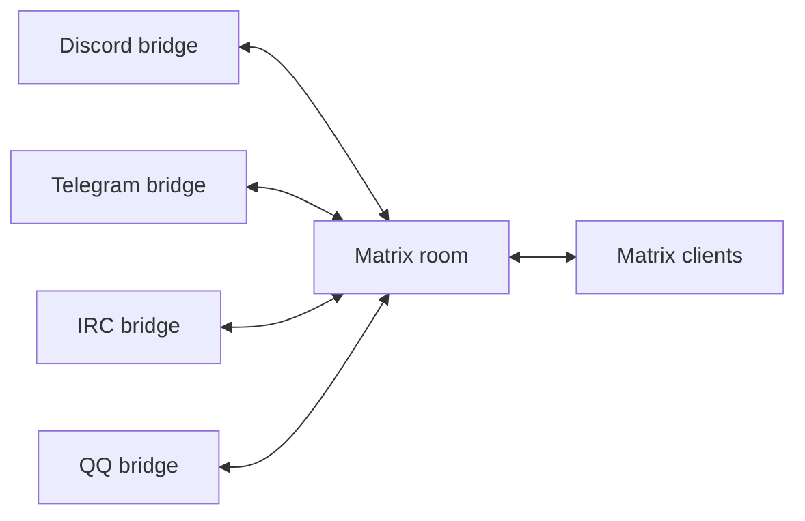

# Architecture

## Topology

A Matrix room is the hub for a community conversation. Each external network is connected through an independently operated Matrix application service. A deployment may contain several communities and several instances of a bridge; the inventory assigns each external endpoint to one room. The homeserver administrator registers each application service with its own credentials and namespaces. Matrix defines registration and transaction delivery in the [Application Service API](https://spec.matrix.org/latest/application-service-api/).

The diagram shows intended connections; each direction requires verification.

Each bridge is a plugin at the deployment boundary: it has its own process, registration, credentials, configuration and persistent state. An additional network can be attached by registering another compatible application service and adding an endpoint to the inventory. The inventory is read-only and does not register, configure or operate bridges.

A common room does not guarantee that bridges relay each other's ghost users. Before connecting real communities, test each directed platform pair with the exact bridge versions, accounts and settings. Check attribution, duplicates, self-echoes, loops, replies, edits, deletes, media and restart behavior. A platform may limit or suppress messages from other bots. Keep a room disconnected if a loop cannot be prevented; names, display names and user-supplied metadata are not trustworthy loop markers.

## Isolation and consent

The inventory prevents an endpoint from being assigned to multiple communities within one bridge instance. It cannot recognize the same endpoint referenced through different bridge instances or aliases; operators must check that separately. Each community needs an explicit room and its participants' consent to cross-network sharing. Matrix membership and the access controls of every external platform determine who can read messages; an inventory check cannot enforce that boundary. Restrict room administration, application-service registrations, bridge management commands and relay-account credentials. A compromised bridge can read and send in the rooms it joins. Treat each bridge as a separate trust domain.

Use separate homeservers or bridge instances when communities require stronger isolation than room permissions and shared service accounts provide. Matrix end-to-end encryption ends at a bridge that decrypts and forwards content. Support depends on the bridge; do not connect an encrypted room until its behavior has been tested.

## Delivery and state

Each bridge owns its delivery semantics, database, queues, platform rate limits and remote message mappings. Matrix acceptance does not prove delivery to another network. Timeouts may leave remote delivery uncertain, and retries may duplicate messages. Record versions and configuration, monitor failed deliveries, and back up the homeserver, bridge databases, registration files, keys and secrets as a coordinated set. Restore tests must include mapping-dependent edits and deletions.

A future routing service would need a durable inbox and per-destination outbox, deduplication, stable transaction identifiers, origin tracking, bounded retries, and an operator-visible failure queue. It would also need a tested way to distinguish authentic bridge senders from user-controlled identities. The current project provides no such service or delivery guarantee.

## Bridge candidates

- **Discord:** [mautrix-discord](https://matrix.org/ecosystem/bridges/discord/) supports relay through a webhook. Its [relay instructions](https://docs.mau.fi/bridges/go/discord/relay.html) require a logged-in account and a webhook for messages from users who have not logged in. Discord prohibits automated normal user accounts; use an approved bot setup ([Discord policy](https://support.discord.com/hc/en-us/articles/115002192352-Automated-User-Accounts-Self-Bots)).
- **Telegram:** [mautrix-telegram](https://matrix.org/ecosystem/bridges/telegram/) supports relay. Instructions depend on the bridge generation; the [relay documentation](https://docs.mau.fi/bridges/general/relay-mode.html) distinguishes current and legacy versions. Telegram's [bot FAQ](https://core.telegram.org/bots/faq#what-messages-will-my-bot-get) describes restrictions on bot-to-bot messages and group visibility; the [Bot API 10.0 release notes](https://core.telegram.org/bots/api#may-8-2026) report that bots can see certain other bot messages in groups. Verify the exact account and bridge behavior.
- **IRC:** [Heisenbridge and matrix-appservice-irc](https://matrix.org/ecosystem/bridges/irc/) are existing application services. Check the IRC network's connection and bot policies.
- **QQ:** The [official bot platform](https://raw.githubusercontent.com/tencent-connect/bot-docs/main/docs/README.md) restricts group capabilities by developer eligibility. Its [send documentation](https://raw.githubusercontent.com/tencent-connect/bot-docs/main/docs/develop/api-v2/server-inter/message/send-receive/send.md) says proactive push ceased on 21 April 2025, while retaining conflicting quota text. Continuous Matrix-to-QQ group delivery is unverified; confirm account permissions and current policy in a sandbox. [matrix-pylon](https://github.com/duo/matrix-pylon) lists OneBot agents as an alternative, but relies on third-party QQ access and its relay behavior, account risks and policy compliance require separate assessment. Its v0.0.3 source stores clients by token ([service.go](https://github.com/duo/matrix-pylon/blob/v0.0.3/pkg/onebot/service.go)) but removes them by client ID ([client.go](https://github.com/duo/matrix-pylon/blob/v0.0.3/pkg/onebot/client.go)); a cancelled login token may remain accepted until restart. This is a source-level finding that has not been tested against a running service. The project's feature list is a maintainer claim, not a verified compatibility result.

Bridge capabilities vary by version and account. None of these candidates has been validated by this project for cross-bridge delivery.
